# Alur Bisnis End-to-End MBKM V2

**Dokumen:** `docs/spec/01-flow-mbkm.md`  
**Status:** Disetujui  
**Versi:** 2.0  
**Tanggal:** 2026-10-26  

> **Dokumen Pasangan:** Spesifikasi state formal (state ID, guard, transisi) ada di [[02-state-machine-mbkm]].
> Dokumen ini menjawab **"siapa melakukan apa, dalam urutan apa"**. Dokumen state machine menjawab **"status apa yang sah, dan apa syarat berpindahnya"**.

---

## 1. Prinsip Dasar Alur

1. **Satu Pintu Masuk Pendaftaran.** Semua pendaftaran masuk lewat stepper 3 tahap, tidak ada jalur paralel di luar sistem.
2. **Pakta Formal Tidak di Awal.** Pendaftaran hanya menyatakan persetujuan umum. Dokumen legal ditandatangani setelah mahasiswa benar-benar diterima mitra.
3. **Satu Mahasiswa, Satu Program Aktif.** Multi-apply diperbolehkan saat melamar, tetapi konfirmasi penerimaan mengunci ke satu program.
4. **KRS Dulu, Dospem Kemudian.** Alokasi Dosen Pembimbing adalah konsekuensi akademik, bukan hadiah pendaftaran. Tanpa KRS terkunci, plotting dilarang.
5. **Kegagalan Administratif Bukan Kegagalan Seleksi.** Revisi pakta/berkas mengembalikan mahasiswa ke antrean, tidak menggugurkan kelolosan.

---

## 2. Golden Flow (Alur Utama)

```mermaid
flowchart TD
    %% FASE 1: EKSPLORASI & PENDAFTARAN
    subgraph F1 ["Fase 1 — Eksplorasi & Pendaftaran (Publik)"]
        A1[Katalog MBKM /mbkm] --> A2[Detail Program /detail-mbkm]
        A2 -->|Tombol Daftar| A3{Login SSO Portal Apps}
        A3 --> A4[Form Pendaftaran 3 Tahap]
        A4 --> A5[Tahap 1: Identitas Studi - tarik data akademik]
        A5 --> A6[Tahap 2: CV, Portofolio, Sertifikat]
        A6 --> A7[Tahap 3: Persetujuan Umum Ketentuan Program]
        A7 -->|Submit| A8[Lamaran Terkirim]
    end

    %% FASE 2: SELEKSI MITRA
    subgraph F2 ["Fase 2 — Seleksi oleh Kontributor / Mitra"]
        A8 --> B1[Antrean Pelamar di Portal Kontributor]
        B1 --> B2{Keputusan Kontributor}
        B2 -->|Tolak| B3[Status Ditolak - selesai]
        B2 -->|Terima| B4[Penawaran Diterbitkan ke Mahasiswa]
    end

    %% FASE 3: KONFIRMASI & PAKTA
    subgraph F3 ["Fase 3 — Konfirmasi Penawaran & Pakta Integritas"]
        B4 --> C1[Mahasiswa Terima / Lepas Penawaran]
        C1 -->|Lepas| C2[Lamaran Ditutup - kuota kembali ke mitra]
        C1 -->|Terima| C3[Lamaran Program Lain Auto-Withdrawn]
        C3 --> C4[Sistem Generate PDF Pakta Kontributor]
        C4 --> C5[Mahasiswa Unduh - Tanda Tangan / E-Materai - Unggah]
        C5 --> C6{Verifikasi Koordinator MBKM}
        C6 -->|Minta Revisi| C5
        C6 -->|Setujui| C7[Pakta Sah - Akses Konversi Terbuka]
    end

    %% FASE 4: AKADEMIK
    subgraph F4 ["Fase 4 — Konversi SKS & Penetapan Dosen Pembimbing"]
        C7 --> D1[Mahasiswa Ajukan Paket Mata Kuliah Konversi]
        D1 --> D2{Koordinator Cek KRS Siadin}
        D2 -->|Belum Terkunci| D3[Menunggu Penguncian KRS]
        D3 --> D2
        D2 -->|Terkunci & Sesuai| D4[Konversi SKS Disetujui]
        D4 --> D5[Koordinator Plotting Dospem + Input Link Grup WA]
        D5 --> D6[Dashboard Mahasiswa Menampilkan Dospem]
    end

    %% FASE 5: PELAKSANAAN
    subgraph F5 ["Fase 5 — Pelaksanaan & Bimbingan"]
        D6 --> E1[Kegiatan Berjalan di Mitra]
        E1 --> E2[Mahasiswa Isi Logbook Berkala]
        E2 --> E3[Dospem Review & ACC Logbook]
        E3 --> E4{Logbook Lengkap?}
        E4 -->|Belum| E2
        E4 -->|Ya| E5[Siap Sidang Evaluasi]
    end

    %% FASE 6: SIDANG
    subgraph F6 ["Fase 6 — Sidang Evaluasi & Finalisasi Akademik"]
        E5 --> G1[Tab Pengajuan: Unggah Laporan, Nilai Mitra, Sertifikat]
        G1 --> G2[Koordinator Verifikasi & Jadwalkan Sidang]
        G2 --> G3[Tab Jadwal: Ujian dengan Dospem & Penguji]
        G3 --> G4[Nilai Akhir Disahkan]
        G4 --> G5[Konversi Nilai Masuk Transkrip Siadin]
    end

    style F1 fill:#f0f9ff,stroke:#0284c7
    style F2 fill:#ecfdf5,stroke:#059669
    style F3 fill:#fef3c7,stroke:#d97706
    style F4 fill:#fdf2f8,stroke:#db2777
    style F5 fill:#faf5ff,stroke:#7c3aed
    style F6 fill:#f8fafc,stroke:#475569
```

---

## 3. Alur Per Peran (Role Journey)

### 3.1 Mahasiswa

| # | Aktivitas | Lokasi Antarmuka | Catatan Aturan |
| :-- | :--- | :--- | :--- |
| 1 | Eksplorasi katalog & detail program | `/mbkm`, `/detail-mbkm` | Wajib login SSO sebelum masuk form pendaftaran |
| 2 | Isi form 3 tahap & submit | `/mahasiswa/pendaftaran` | Data akademik ditarik otomatis, tidak bisa diedit manual |
| 3 | Pantau status lamaran | `/mahasiswa/dashboard` | Bisa punya maksimal 3 lamaran aktif paralel |
| 4 | Terima / lepas penawaran | `/mahasiswa/dashboard` | Batas waktu konfirmasi 3×24 jam |
| 5 | Unduh & unggah pakta integritas | `/mahasiswa/dashboard` | PDF terisi otomatis, tinggal tanda tangan + unggah |
| 6 | Ajukan paket konversi mata kuliah | `/mahasiswa/konversi-sks` | Baru terbuka setelah pakta disetujui |
| 7 | Isi logbook berkala | `/mahasiswa/logbook` | Baru terbuka setelah Dospem ditetapkan |
| 8 | Ajukan sidang (Tab Pengajuan) | `/mahasiswa/sidang` | Upload laporan akhir, nilai mitra, sertifikat |
| 9 | Pantau jadwal & hasil (Tab Jadwal) | `/mahasiswa/sidang` | Menampilkan penguji, ruang/meet, nilai akhir |

### 3.2 Kontributor / Mitra

| # | Aktivitas | Lokasi Antarmuka | Catatan Aturan |
| :-- | :--- | :--- | :--- |
| 1 | Kelola program & kuota | `/contributor/program` | Menentukan hak, kewajiban, target luaran |
| 2 | Seleksi pelamar | `/contributor/seleksi` | Tombol Terima / Tolak, tanpa akses data kurikulum |
| 3 | Kelola konten publik program | `/contributor/kelola-cms` | Upload banner & foto profil (dropzone) |
| 4 | Monitoring mahasiswa aktif | `/contributor/anggota` | Melihat kehadiran & progres, bukan nilai akademik |

### 3.3 Koordinator MBKM

| # | Aktivitas | Lokasi Antarmuka | Catatan Aturan |
| :-- | :--- | :--- | :--- |
| 1 | Atur periode & form pendaftaran | `/admin/periode`, `/admin/form-pendaftaran` | Konfigurasi sekali per semester |
| 2 | Kelola direktori kontributor | `/admin/kontributor` | Tab relasi: mahasiswa + dospem per mitra |
| 3 | Pantau & export data pendaftar | `/admin/pelamar` | Export Excel + unduh berkas (CV, portofolio, sertifikat) |
| 4 | Verifikasi pakta integritas | `/admin/pelamar` | Setujui atau Minta Revisi (tidak menggugurkan) |
| 5 | Verifikasi konversi & kunci KRS | `/admin/konversi` | Gatekeeper wajib sebelum plotting |
| 6 | Plotting Dosen Pembimbing | `/admin/dosen-update` | Wajib isi tautan grup WhatsApp bimbingan |
| 7 | Verifikasi berkas & jadwalkan sidang | `/admin/sidang`, `/admin/gelombang` | Menetapkan penguji dan slot waktu |
| 8 | Sahkan hasil sidang | `/admin/hasil-sidang` | Meneruskan nilai ke transkrip |

### 3.4 Dosen Pembimbing

| # | Aktivitas | Lokasi Antarmuka | Catatan Aturan |
| :-- | :--- | :--- | :--- |
| 1 | Lihat daftar mahasiswa bimbingan | `/dosen/mahasiswa` | Muncul hanya setelah plotting selesai |
| 2 | Review & ACC logbook | `/dosen/logbook` | Bisa memberi catatan per entri |
| 3 | Review laporan akhir | `/dosen/laporan-akhir` | Prasyarat pengajuan sidang |
| 4 | Menguji sidang & input nilai | `/dosen/sidang` | Bobot 40% (penguji mandiri 60%) |

---

## 4. Aturan Bisnis Kunci

### 4.1 Dualitas Pakta Integritas

| Dimensi | Pakta 1: Persetujuan Umum | Pakta 2: Pakta Kontributor |
| :--- | :--- | :--- |
| **Kapan** | Saat submit pendaftaran (Tahap 3) | Setelah menerima penawaran mitra |
| **Bentuk** | 3 checkbox pernyataan di form | Dokumen PDF legal, di-generate sistem |
| **Isi** | Kebenaran data & ketaatan aturan fakultas | Hak, kewajiban kerja, NDA, target luaran mitra |
| **Verifikator** | Otomatis (tersimpan saat submit) | Koordinator MBKM (manual) |
| **Jika cacat** | Form tidak bisa dikirim | Revisi unggahan, kelolosan tetap sah |

### 4.2 Multi-Application & Auto-Withdrawal

1. Mahasiswa boleh punya maksimal **3 lamaran aktif** dalam satu periode.
2. Bila diterima di lebih dari satu program, semua berstatus `OFFERED` dan mahasiswa memilih satu.
3. Begitu satu penawaran diterima, lamaran lain otomatis menjadi `WITHDRAWN_AUTO` dan kuotanya dikembalikan ke antrean mitra.
4. Bila mahasiswa melewatkan batas konfirmasi 3×24 jam, penawaran kedaluwarsa (`OFFER_EXPIRED`) dan kuota kembali ke mitra.

### 4.3 Gatekeeper KRS sebelum Plotting Dospem

1. Pengumuman kelolosan mitra **wajib selesai sebelum masa KRS** universitas dibuka.
2. Tombol *Assign Dosen Pembimbing* berstatus `disabled` selama konversi belum berstatus `KRS_LOCKED_VERIFIED`.
3. Tooltip penjelasan:
   > *"Dosen Pembimbing belum dapat ditetapkan: mahasiswa belum menyelesaikan validasi konversi SKS dan penguncian KRS Siadin."*
4. Setelah KRS terkunci dan sesuai, plotting terbuka dan **wajib** mengisi tautan grup WhatsApp bimbingan.

### 4.4 Representasi Dospem di Dashboard Mahasiswa

- Menu sidebar `Dosen Pembimbing` **dihapus**.
- **Sebelum plotting:** kartu netral berisi
  > *"Dosen Pembimbing belum ditetapkan. Alokasi akan diterbitkan setelah pakta integritas dan konversi KRS divalidasi Koordinator MBKM."*
- **Setelah plotting:** avatar, nama bergelar, NIDN, email institusi, dan komponen **Grup WhatsApp Bimbingan** (field read-only + tombol Salin Tautan + Buka Grup).

---

## 5. Alur Alternatif (Exception Paths)

| Skenario | Alur Penanganan |
| :--- | :--- |
| **Ditolak semua mitra** | Lamaran `REJECTED`. Mahasiswa kembali ke status tanpa program; tidak ada pakta, tidak ada dospem. Dashboard kembali ke mode pendaftaran. |
| **Penawaran kedaluwarsa** | `OFFER_EXPIRED` setelah 3×24 jam tanpa konfirmasi. Kuota mitra dilepas otomatis. Mahasiswa dapat melamar program lain bila periode masih buka. |
| **Pakta ditolak berulang** | Tetap di `PAKTA_REVISION`. Tidak ada batas jumlah revisi, tetapi tercatat di log aktivitas untuk evaluasi Koordinator. |
| **KRS tidak sesuai usulan konversi** | Konversi dikembalikan ke mahasiswa untuk disesuaikan dengan mata kuliah yang benar-benar diambil di Siadin. |
| **Mahasiswa mundur setelah dospem ditetapkan** | Koordinator melepas plotting, membuka kembali slot dospem, dan mahasiswa dikembalikan ke status `WITHDRAWN_MANUAL`. |
| **Mahasiswa hilang kontak (ghosting)** | Logbook tidak terisi >7 hari memicu status kritis di dashboard Koordinator & Dospem untuk pemanggilan. |
