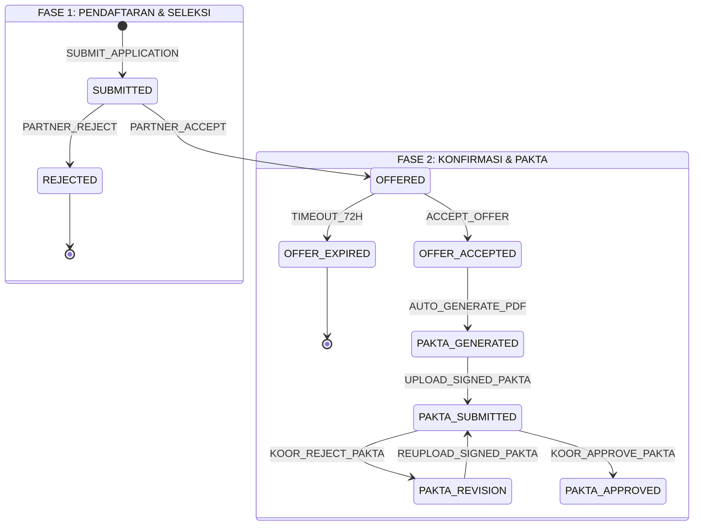
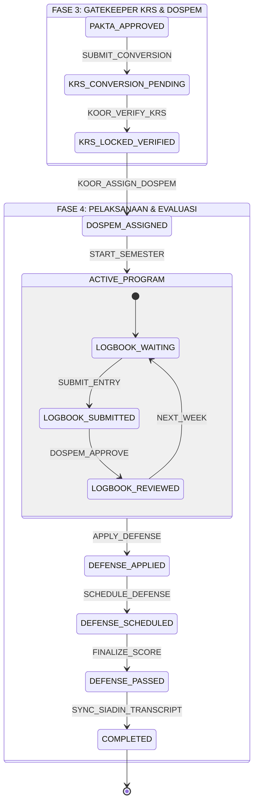

# Spesifikasi State Machine MBKM V2

**Dokumen:** `docs/spec/02-state-machine-mbkm.md`  
**Status:** Disetujui  
**Versi:** 2.0  
**Tanggal:** 2026-10-26  

> **Dokumen Pasangan:** Alur interaksi pengguna dan urutan proses antar-peran ada di [[01-flow-mbkm]].
> Dokumen ini menjawab **"status apa yang sah, event apa yang memicu perubahan, dan aturan apa yang menjaganya"**.

---

## 1. Definisi State Lengkap

Sistem mengenal 17 state resmi yang terbagi ke dalam 5 fase siklus hidup:

| State ID | Fase | Label UI | Warna Badge | Deskripsi |
| :--- | :--- | :--- | :--- | :--- |
| `SUBMITTED` | Pendaftaran | Menunggu Seleksi | Kuning (`bg-amber-50 text-amber-700`) | Berkas pendaftaran telah dikirim, masuk ke antrean kontributor |
| `REJECTED` | Seleksi | Ditolak Mitra | Merah (`bg-rose-50 text-rose-700`) | Kontributor menolak berkas pendaftaran mahasiswa |
| `OFFERED` | Seleksi | Lolos Seleksi | Hijau muda (`bg-emerald-50 text-emerald-700`) | Kontributor menerima mahasiswa, menunggu konfirmasi penerimaan |
| `OFFER_ACCEPTED` | Konfirmasi | Diterima | Hijau (`bg-emerald-100 text-emerald-800`) | Mahasiswa mengonfirmasi penawaran, lamaran lain di-withdraw otomatis |
| `OFFER_EXPIRED` | Konfirmasi | Kedaluwarsa | Abu-abu (`bg-slate-100 text-slate-600`) | Mahasiswa tidak mengonfirmasi dalam 3×24 jam, kuota dilepas |
| `PAKTA_GENERATED` | Pakta | Menunggu Pakta | Biru muda (`bg-sky-50 text-sky-700`) | PDF pakta spesifik kontributor telah terbit, menunggu tanda tangan |
| `PAKTA_SUBMITTED` | Pakta | Verifikasi Pakta | Biru (`bg-blue-50 text-blue-700`) | Mahasiswa telah mengunggah pakta, menunggu telaah Koordinator |
| `PAKTA_REVISION` | Pakta | Revisi Pakta | Oranye (`bg-amber-100 text-amber-800`) | Koordinator meminta perbaikan dokumen pakta (cacat/buram/tanpa materai) |
| `PAKTA_APPROVED` | Pakta | Pakta Sah | Zamrud (`bg-emerald-50 text-emerald-700`) | Dokumen pakta dinyatakan sah oleh Koordinator |
| `KRS_CONVERSION_PENDING` | Akademik | Verifikasi KRS | Ungu muda (`bg-purple-50 text-purple-700`) | Mahasiswa mengajukan paket mata kuliah konversi, menunggu cek Siadin |
| `KRS_LOCKED_VERIFIED` | Akademik | KRS Terkunci | Ungu (`bg-purple-100 text-purple-800`) | Koordinator memvalidasi KRS Siadin telah fix dan sesuai konversi |
| `DOSPEM_ASSIGNED` | Akademik | Dospem Ditetapkan | Biru tua (`bg-indigo-50 text-indigo-700`) | Koordinator telah menetapkan Dosen Pembimbing dan tautan grup WA |
| `ACTIVE_PROGRAM` | Pelaksanaan | Kegiatan Berjalan | Hijau pekat (`bg-emerald-600 text-white`) | Mahasiswa aktif berkegiatan dan mengisi logbook berkala |
| `DEFENSE_APPLIED` | Evaluasi | Menunggu Sidang | Kuning (`bg-amber-50 text-amber-700`) | Laporan akhir, nilai mitra, dan sertifikat diunggah |
| `DEFENSE_SCHEDULED` | Evaluasi | Sidang Terjadwal | Biru (`bg-blue-100 text-blue-800`) | Jadwal, penguji, dan ruang/link meet telah ditetapkan |
| `DEFENSE_PASSED` | Evaluasi | Lulus Sidang | Hijau (`bg-emerald-100 text-emerald-800`) | Sidang selesai, berita acara dan nilai akhir disahkan |
| `COMPLETED` | Selesai | Selesai | Abu-abu pekat (`bg-slate-800 text-white`) | Nilai konversi resmi masuk ke transkrip Siadin |

---

## 2. Diagram State Machine Formal

Diagram dipecah menjadi dua bagian agar tetap terbaca pada media cetak maupun layar sempit. Bagian 2.1 mencakup fase pendaftaran hingga pakta integritas; bagian 2.2 melanjutkan dari gatekeeper KRS hingga siklus selesai.

### 2.1 Fase 1 & 2 — Pendaftaran, Seleksi, Konfirmasi, dan Pakta Integritas

### 2.2 Fase 3 & 4 — Gatekeeper KRS, Penetapan Dospem, Bimbingan, dan Sidang

---

## 3. Matriks Transisi State & Guard Conditions

| Dari State | Event / Trigger | Aktor | Guard Condition (Syarat Sah) | Ke State | Side Effect / Efek Samping |
| :--- | :--- | :--- | :--- | :--- | :--- |
| `[*]` | `SUBMIT_APPLICATION` | Mahasiswa | Mengisi form stepper (data identitas valid, IPK $\ge 3.00$, SKS $\ge 80$, 3 checkbox persetujuan dicentang) | `SUBMITTED` | Berkas masuk ke antrean seleksi mitra di `/contributor/seleksi` |
| `SUBMITTED` | `PARTNER_ACCEPT` | Kontributor | Kuota program masih tersedia | `OFFERED` | Banner penawaran lolos tampil di dashboard mahasiswa; timer 72 jam berjalan |
| `SUBMITTED` | `PARTNER_REJECT` | Kontributor | Catatan penolakan diisi (opsional) | `REJECTED` | Status lamaran ditutup; kuota tidak berkurang |
| `OFFERED` | `ACCEPT_OFFER` | Mahasiswa | Waktu belum lewat batas 72 jam | `OFFER_ACCEPTED` | **Semua lamaran lain mahasiswa di program lain otomatis berstatus `WITHDRAWN_AUTO`** |
| `OFFERED` | `TIMEOUT_72H` | Sistem | Melewati 72 jam tanpa aksi konfirmasi | `OFFER_EXPIRED` | Kuota dikembalikan ke antrean mitra untuk kandidat cadangan |
| `OFFER_ACCEPTED` | `AUTO_GENERATE_PDF`| Sistem | Data mahasiswa & klausul kewajiban mitra lengkap | `PAKTA_GENERATED` | Dokumen PDF resmi siap diunduh di dashboard |
| `PAKTA_GENERATED` | `UPLOAD_SIGNED_PAKTA` | Mahasiswa | File PDF bertanda tangan & materai diunggah | `PAKTA_SUBMITTED` | Berkas masuk ke antrean verifikasi Koordinator di `/admin/pelamar` |
| `PAKTA_SUBMITTED` | `KOOR_APPROVE_PAKTA` | Koordinator | Dokumen terbaca jelas, tanda tangan sah | `PAKTA_APPROVED` | Tab konversi mata kuliah di `/mahasiswa/konversi-sks` terbuka |
| `PAKTA_SUBMITTED` | `KOOR_REJECT_PAKTA` | Koordinator | Catatan alasan penolakan wajib diisi | `PAKTA_REVISION` | Kartu status mahasiswa berubah oranye dengan pesan revisi; kelulusan tidak gugur |
| `PAKTA_REVISION` | `REUPLOAD_SIGNED_PAKTA`| Mahasiswa | Berkas pengganti diunggah | `PAKTA_SUBMITTED` | Kembali ke antrean telaah Koordinator |
| `PAKTA_APPROVED` | `SUBMIT_CONVERSION` | Mahasiswa | Total SKS usulan $\le 20$ SKS | `KRS_CONVERSION_PENDING` | Masuk ke antrean verifikasi konversi Koordinator |
| `KRS_CONVERSION_PENDING` | `KOOR_VERIFY_KRS` | Koordinator | **KRS di Siadin telah terkunci & mata kuliah identik** | `KRS_LOCKED_VERIFIED` | **Membuka kunci aksi assign Dospem di `/admin/dosen-update`** |
| `KRS_LOCKED_VERIFIED` | `KOOR_ASSIGN_DOSPEM` | Koordinator | Dospem memiliki kuota bimbingan & **tautan grup WA terisi** | `DOSPEM_ASSIGNED` | Kartu Dospem di dashboard mahasiswa aktif + tautan WAG bimbingan |
| `DOSPEM_ASSIGNED` | `START_SEMESTER` | Sistem | Tanggal mulai periode MBKM tercapai | `ACTIVE_PROGRAM` | Mode dashboard beralih ke monitoring kegiatan; form pendaftaran disembunyikan |
| `ACTIVE_PROGRAM` | `APPLY_DEFENSE` | Mahasiswa | Logbook selesai $100\%$, draf laporan, nilai mitra, dan sertifikat terunggah | `DEFENSE_APPLIED` | Masuk ke antrean penjadwalan sidang di `/admin/sidang` |
| `DEFENSE_APPLIED` | `SCHEDULE_DEFENSE` | Koordinator | Slot gelombang sidang & 2 penguji (Dospem + Penguji Mandiri) teralokasi | `DEFENSE_SCHEDULED` | Jadwal, ruang, penguji, dan link meet tampil di Tab Jadwal Sidang mahasiswa |
| `DEFENSE_SCHEDULED` | `FINALIZE_SCORE` | Penguji | Form nilai penguji 1 & 2 terisi lengkap | `DEFENSE_PASSED` | Berita acara sidang ditandatangani digital |
| `DEFENSE_PASSED` | `SYNC_SIADIN_TRANSCRIPT`| Kaprodi & BAAK | Berita acara sah & nilai huruf per-matkul terbit | `COMPLETED` | Nilai masuk ke transkrip Siadin; siklus MBKM mahasiswa selesai |

---

## 4. Invarian Sistem (Aturan yang Tidak Boleh Dilanggar)

1. **Invarian 1 (Zero-Ghost Tutoring):**
   $$\text{State}(\text{Dosen Assigned}) \implies \text{State}(\text{KRS}) = \text{KRS\_LOCKED\_VERIFIED}$$
   Dosen Pembimbing tidak pernah bisa ditugaskan sebelum KRS mahasiswa terkunci dan terverifikasi.

2. **Invarian 2 (Single Active Acceptance):**
   $$\forall m \in \text{Mahasiswa}, \quad \sum (\text{Lamaran Aktif}(m) \text{ berstatus } \text{OFFER\_ACCEPTED}) \le 1$$
   Mahasiswa dilarang memiliki lebih dari satu penawaran yang diterima aktif secara bersamaan.

3. **Invarian 3 (Non-Destructive Revision):**
   $$\text{Transition}(\text{PAKTA\_SUBMITTED} \rightarrow \text{PAKTA\_REVISION}) \not\Rightarrow \text{Lamaran Batal}$$
   Penolakan dokumen pakta tidak membatalkan status kelolosan mahasiswa di mitra.

4. **Invarian 4 (Mandatory Communication Channel):**
   $$\text{Assign}(\text{Dospem}) \implies \text{Link WhatsApp Group} \neq \emptyset$$
   Penugasan dosen pembimbing wajib menyertakan tautan grup koordinasi bimbingan resmi.

---

## 5. Pemetaan State ke Antarmuka Mahasiswa (`Alpine.store / Mock State`)

| State Grup | Nilai `$store.mahasiswaSim.state` | Tampilan Dashboard Mahasiswa | Visibilitas Menu Sidebar |
| :--- | :--- | :--- | :--- |
| **Pra-Penerimaan** | `'belum_daftar'` | Stepper pendaftaran, kartu riwayat lamaran aktif, banner tawaran mitra | Dashboard, Pengumuman, Katalog, Form Pendaftaran, Status Pengajuan |
| **Pasca-Penerimaan** | `'lolos_seleksi'` | Kartu penawaran lolos, tombol download draf pakta, dropzone upload pakta | Dashboard, Pengumuman, Status Pengajuan, Konversi SKS |
| **Kegiatan Aktif** | `'aktif'` | Kartu Dosen Pembimbing (+ tautan WAG), ringkasan logbook mingguan, tombol pengajuan sidang | Dashboard, Pengumuman, Logbook Kegiatan, Konversi SKS, Sidang Evaluasi, Sertifikat |
| **Selesai** | `'selesai'` | Rangkuman nilai akhir, tombol unduh transkrip konversi, sertifikat kegiatan | Dashboard, Pengumuman, Sidang Evaluasi, Sertifikat |
